<p align="center"></p>

# Gold Trend Sentinel (MetaTrader 5 and MetaTrader 4)

A free Expert Advisor that follows gold on **H4**: a UT Bot entry, filtered by the daily trend and Supertrend, with a
3 x ATR stop that trails behind the best price. XAUUSD only, fixed 0.01 lot. Source for both editions, a Python statement of
the rule, tests, and the honest backtest evidence, which is **promising but unproven**.

**Website:** [allanninal.dev/mql5/gold-trend-sentinel](https://www.allanninal.dev/mql5/gold-trend-sentinel/) · [MT4 editions](https://www.allanninal.dev/mql5/#mt4) · [allanninal.dev](https://www.allanninal.dev)
· **Contact:** message me on [LinkedIn](https://www.linkedin.com/in/allanninal/).

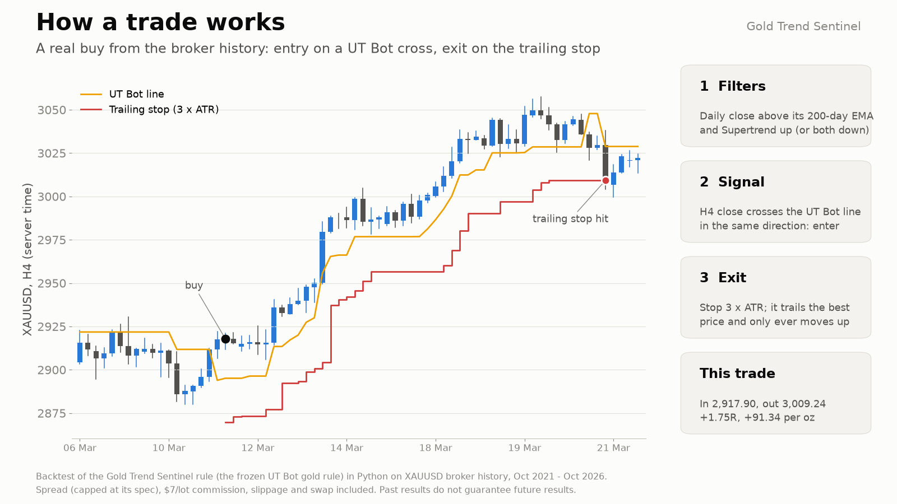

> This EA promises no profit. Every number here is a backtest on broker history, not live trading. See
> [What the evidence does and does not show](#what-the-evidence-does-and-does-not-show).

## Get it on the MQL5 Market

| Edition | Platform | Price | Link |
|---|---|---|---|
| Gold Trend Sentinel | MT5 | free | <https://www.mql5.com/en/market/product/200427> |
| Gold Trend Sentinel MT4 | MT4 | free | MT4 edition: coming soon on the MQL5 Market |
| Gold Trend Sentinel PRO | MT5 | paid | <https://www.mql5.com/en/market/product/201334> |
| Gold Trend Sentinel Pro MT4 | MT4 | paid | MT4 edition: coming soon on the MQL5 Market |

The Market builds are the same strategy code as the source in this repository. The PRO edition is a separate, paid product
that is **not** part of this repository (see [Free vs Pro](#free-vs-pro)).

## Contents

1. [What it is and who it is for](#what-it-is-and-who-it-is-for)
2. [Why it was built](#why-it-was-built)
3. [How it works](#how-it-works)
4. [What the evidence does and does not show](#what-the-evidence-does-and-does-not-show)
5. [How it was tested](#how-it-was-tested)
6. [Architecture](#architecture)
7. [Inputs, install and compile](#inputs-install-and-compile)
8. [Run the Python reference and the tests](#run-the-python-reference-and-the-tests)
9. [Honest limits](#honest-limits)
10. [Free vs Pro](#free-vs-pro)
11. [Licence and credits](#licence-and-credits)

## What it is and who it is for

**What:** on each new H4 bar the EA looks at the bar that just closed. It buys when the close crosses above the UT Bot line
(key 1.5, ATR 10) while the last completed daily close is above its EMA(200) and Supertrend(10, 3) on H4 is up; a sell is the
mirror. The order goes in at the bar's open with a stop 3 x ATR(14) away, which then trails 3 x ATR behind the best price
since entry, tightened once per H4 bar and never loosened. There is no target. An opposite signal reverses the trade. The
lot is 0.01, or the broker's minimum when that is larger. A panel shows the filters, the UT Bot line, the position and the
results.

**Safety checks:** every order is checked for margin and for surviving its stop above the broker's stop-out level, with twice
the loss at the stop counted as a gap allowance. Live and demo charts trade **XAUUSD only**; the Strategy Tester accepts any
symbol.

**For:** traders who want this exact, slow, rule-based gold trend follower automated and who read the evidence first. Also for
developers who want a tested EA with a Python statement of its rule.

**Not for:** anyone expecting a proven edge. It has long flat and losing stretches by construction (a trend follower with
a wide stop), and the sell side lost money in the backtest.

| | |
|---|---|
| 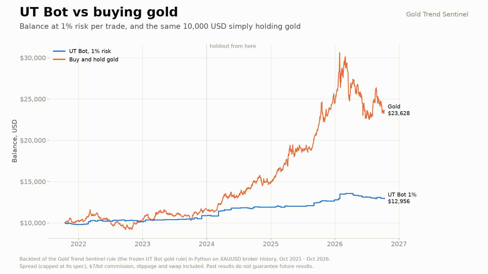 | 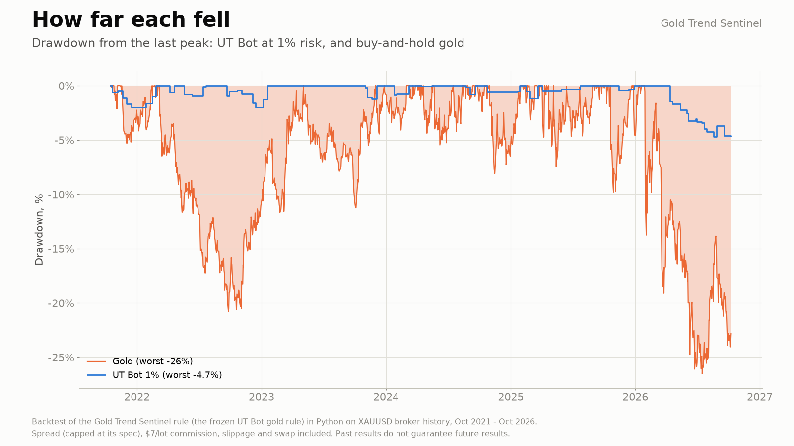 |
| 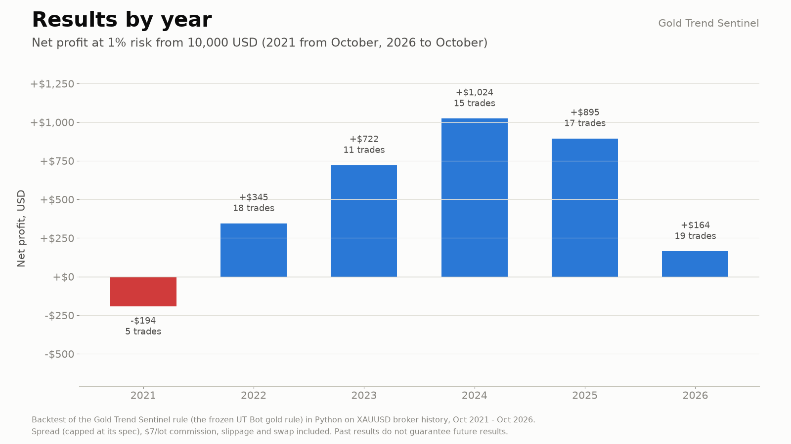 | 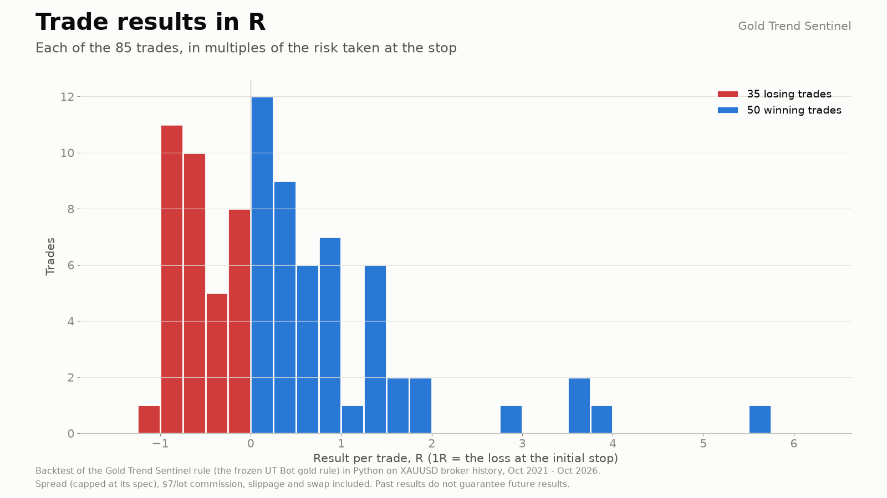 |

More charts: [results by month](docs/images/05-results-by-month.png), [buys and sells](docs/images/07-buys-and-sells.png).
Image notes: the charts are drawn by a script from a Python backtest on XAUUSD broker history, October 2021 to October 2026,
at 1% risk per trade from 10,000 USD (spread capped at its spec, a USD 7 per lot commission, slippage and swap included). The
EA itself trades a fixed 0.01 lot; the charts are illustrations of the rule, not terminal captures.

## Why it was built

The motivations, stated with the evidence we actually have:

- **A frozen rule from a gold research project.** The rule was found in a research lab for gold: a pre-registered search
  over about 105,000 settings (H1, H4 and D1 only). **No family passed the deflated-Sharpe test** for that many trials.
  The UT Bot H4 rule was the most promising one in a one-shot holdout (2024-01 to 2026-09: Sharpe 1.55, alpha +5.4% a year,
  t 1.80, beta 0.07), which the project calls "promising, unproven". The rule was then frozen and built as this EA.
- **Weak demand, stated plainly.** Gold trend followers are crowded on the MQL5 Market, and we found no demand specific to
  this rule. UT Bot itself is one of the most copied TradingView scripts, but a named classic like it is requested only
  rarely by name. This is a free, transparent reference implementation of one frozen rule.
- **The real test is forward data.** The research period is spent: 2021 to 2023 was research and 2024 to 2026 the one-shot
  holdout, so the backtest below is not new out-of-sample evidence. A forward paper-trading test from 2026-10-01 is the
  decider.

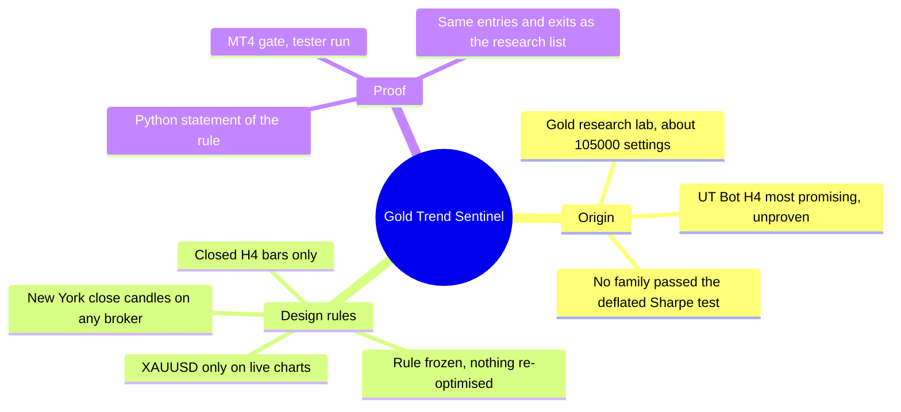

## How it works

### The rule, step by step

`C` is the bar's close, `i` the bar index (oldest = 0).

1. **True range and ATRs.** `TR[i] = max(H-L, |H-C[i-1]|, |L-C[i-1]|)`. `ATR_n` is Wilder's RMA of the TR, seeded with the
   simple average of the first `n` values (as TradingView): `ATR[i] = (ATR[i-1] x (n-1) + TR[i]) / n`.
2. **UT Bot line** (key `k` = 1.5, ATR 10, on the close), `nLoss = k x ATR10`:
   - close above the line on this and the previous bar: `line = max(line[i-1], C - nLoss)`
   - close below it on both: `line = min(line[i-1], C + nLoss)`
   - otherwise (the first bar after a flip): `C - nLoss` if `C > line[i-1]`, else `C + nLoss`.
3. **Supertrend(10, 3)** on `(H+L)/2` with `ATR10` and multiplier 3: upper and lower bands that only tighten, the trend flips
   when the close passes the opposite band. Up is `+1`, down `-1`.
4. **Daily trend.** The last **completed** daily close against `EMA(200)` of the daily closes (seeded with the SMA of the first
   200 closes): above is `+1`, below `-1`.
5. **Signal on the closed bar `j`.** Buy: `C[j] > line[j]` and `C[j-1] <= line[j-1]` and daily trend `+1` and Supertrend `+1`.
   Sell: the mirror.
6. **Order.** At the next bar's open: a buy at the ask, a sell at the bid. Stop `= fill -/+ 3 x ATR14`. No target.
7. **Trail.** Once per new H4 bar: `best` = the best price since the start of the entry bar (bid highs for a buy, ask lows for a
   sell); new stop `= best -/+ dist`, where `dist` is the entry distance kept for the life of the trade. It only tightens. If
   the new stop is already through the price, the trade closes at that bar's open.
8. **Reverse.** An opposite signal closes the trade and opens the other side at the same open. A same-side signal is ignored
   (the trail is still tightened).

**Candles.** The rule was researched on New York-close candles (server time UTC+2, or UTC+3 while US daylight saving is on).
On a broker with another server clock the EA rebuilds H4 and D1 candles from H1 on that clock (input "Broker server clock":
Auto, New York close, UTC+2/+3 with EU daylight saving, or a fixed offset), so the signals stay the same.

### Per-bar algorithm

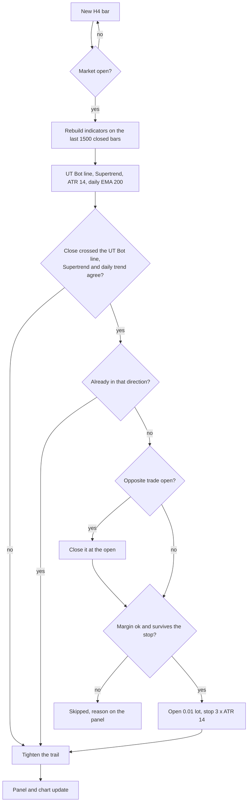

### Trade states

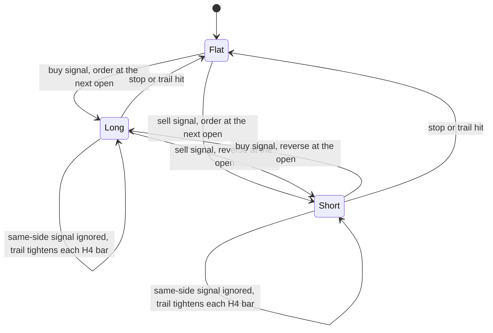

### From signal to order

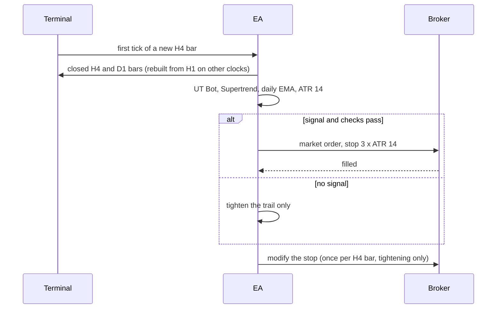

## What the evidence does and does not show

Python backtest on XAUUSD broker history, October 2021 to October 2026, at 1% risk per trade from 10,000 USD, spread,
commission (USD 7 per lot), slippage and swap included. Source: the charts in [`docs/images/`](docs/images).

| | |
|---|---|
| Trades | 85 (50 winners, 35 losers) |
| Net result | +2,956 USD, profit factor 2.45, worst drawdown 4.7% |
| Alpha against holding gold | +5.0% a year, t 2.52, beta 0.07 |
| Holding gold over the same years | +136% with a 26% drawdown (it made more) |
| Buys / sells | +35.5 R from 64 buys, -4.4 R from 21 sells |

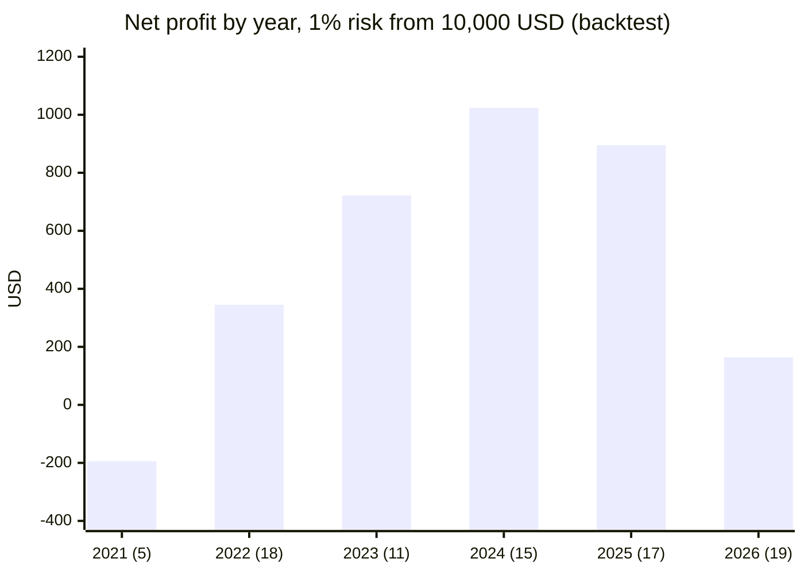

(Trades per year in brackets; 2021 is October to December.)

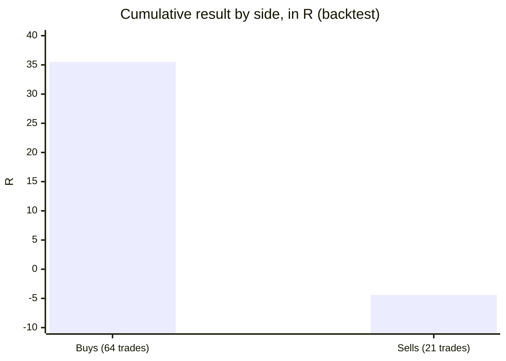

Read them with care:

- **Not new evidence.** 2021 to 2023 was research and 2024 to 2026 the one-shot holdout, now spent. The forward test from
  2026-10-01 is the real one.
- **Multiple testing.** The rule was chosen from about 105,000 settings; none passed the deflated-Sharpe test.
- **It made less than buying gold.** The point of the rule is a much smaller drawdown (4.7% against 26%), not more profit.
- **All of the profit came from buys,** in a period when gold rose strongly. Sells lost slightly.
- **Small sample:** 85 trades in five years.

## How it was tested

| Check | Result |
|---|---|
| Rule invariants on synthetic data, 20 seeds, 977 trades ([`tests/check_reference.py`](tests/check_reference.py)) | PASS, 0 violations |
| Reference vs the research trade list, XAUUSD H4, entries 2023-07 to 2026-09 | 57 of 57 closed trades: same entry time and direction, same exit time |
| EA indicator code vs the research rule, Oct 2021 to Oct 2026 | 112 of 112 signals identical |
| EA trade handling vs the research engine (version 1.01) | 85 of 85 trades identical |
| Candles rebuilt on other broker clocks (version 1.04) | 18,157 H4 and 3,033 D1 candles identical to the New York-close candles |
| MT4 publish gate, Python half (58 trades) | PASS: mean R +0.447, t 2.65, PF 3.01 |
| MT4 publish gate, MT4 Strategy Tester half (every tick) | PASS: 57 trades vs 58, signals 74 of 74 identical, mean R +0.433, t 2.53, PF 2.86, halves +0.552 / +0.333 |
| MT4 validator-style runs (default inputs, 2025-10 to 2026-10, every tick) | PASS, 0 error lines: EURUSD H1 15 trades, XAUUSD D1 24, XAUUSD H4 24, GBPJPY H1 13 |
| MT5 and MT4 editions compiled with MetaEditor (clean scratch folder, only this repository's files) | 0 errors, 0 warnings each |
| MT5 Market build | passed the MQL5 Market's automated product validation before publication (the Market's own check) |

Sources: [`tests/results/`](tests/results). The 112 / 85 / clock checks come from scripts that need the author's private research
environment, so they are not published; the numbers are as recorded there. The MT4 gate criteria were written before any
number was computed: at least 40 trades; mean R > 0 and t >= 2.0; profit factor >= 1.20; both halves positive. The MT5 edition was
published before the publish gate existed, so only the MT4 edition went through it.

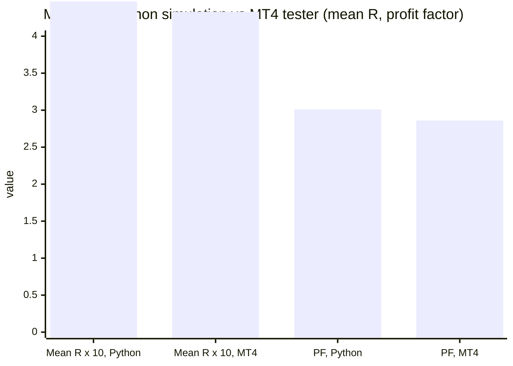

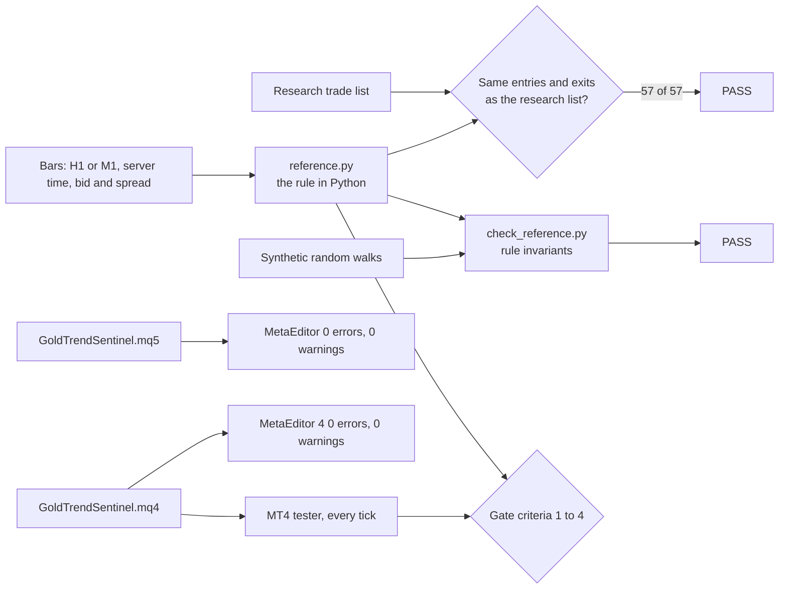

**Not covered:** forward (live) trading; the MT5 Strategy Tester was not part of a gate; the reference is checked on entries
and exit times, not on tick-level fills; the 112, 85 and clock checks cannot be re-run from this repository.

## Architecture

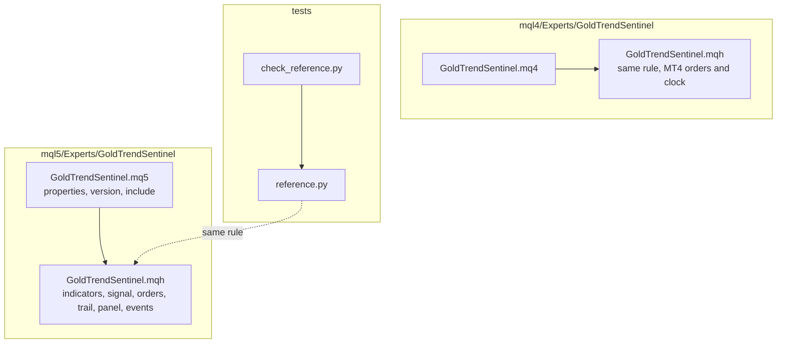

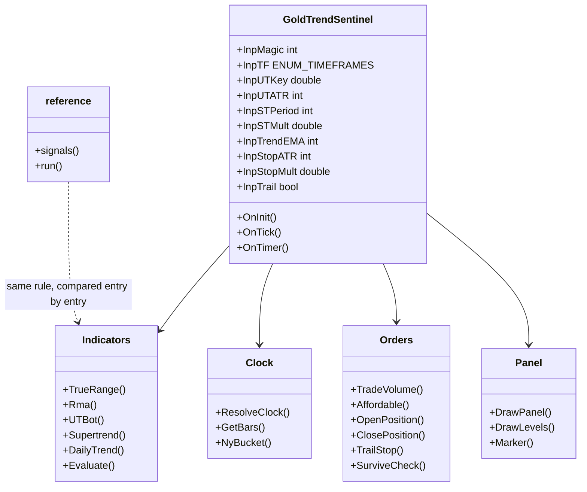

## Inputs, install and compile

| Input | Default | Meaning |
|---|---|---|
| Magic number | 770100 | identifies this EA's position |
| Signal timeframe | H4 | the rule was researched on H4 |
| UT Bot key value / ATR period | 1.5 / 10 | the frozen UT Bot parameters |
| Supertrend ATR period / multiplier | 10 / 3.0 | the frozen Supertrend parameters |
| Daily trend EMA period | 200 | daily EMA of the filter |
| Stop ATR period / Stop and trail, x ATR | 14 / 3.0 | the stop and trail distance |
| Trail the stop | true | switch the trail off to keep the first stop |
| Broker server clock / fixed UTC offset | Auto / 0 | how H4 and D1 candles are aligned |
| Panel, UT Bot line, light theme, corner, margins, font size | on, on, off, top left, 10 / 26 px, 9 | display |
| Debug log | off | one line per bar with everything a bug report needs |

The defaults are the tested settings; no set file is needed. Changing the strategy inputs leaves the tested rule.

**Install from source.** Copy the `mql5/Experts/GoldTrendSentinel` folder into `<terminal data folder>/MQL5/Experts/` (MT5) or
the `mql4/Experts/GoldTrendSentinel` folder into `<data folder>/MQL4/Experts/` (MT4). Open `GoldTrendSentinel.mq5` or `.mq4`
in MetaEditor and press Compile (F7). Both compile with 0 errors and 0 warnings. Keep the three files of each edition
together (the program, its `.mqh` core and the icon).

**Run it.** Attach it to an XAUUSD chart (a prefixed or suffixed name is fine) and keep Algo Trading (MT5) or AutoTrading
(MT4) on. The stop is wide: at 0.01 lot it is roughly USD 115 in 2026 (3 x ATR(14) on H4), so keep the account large enough to
survive it. The EA's own checks refuse an order the account cannot carry.

## Run the Python reference and the tests

```bash
python3 -m venv .venv && . .venv/bin/activate && pip install -r requirements.txt
python3 tests/check_reference.py                 # synthetic data, no broker history needed; prints PASS or FAIL
```

```python
import sys; sys.path.insert(0, "tests")
from reference import run
# h4, d1: DataFrames indexed by bar open time (server time) with open, high, low, close (bid);
# spread: a Series per H4 bar in price units (ask = bid + spread)
trades = run(h4, d1, spread)      # one row per closed trade, gross of swap
```

The broker price history and the research trade list used for the published numbers are not in this repository.

## Honest limits

- **No proven edge.** The rule survived a one-shot holdout with a t-statistic around 1.8 to 2.5 depending on the data and
  the period, was picked from about 105,000 settings, and has not been through forward trading yet.
- **It lost to buy-and-hold on profit.** It aims at a smaller drawdown, not a larger return.
- **Sells lost money** in the backtest; the profit is the buy side in a rising gold market.
- **Few trades:** 85 in five years. Flat and losing stretches of months are normal for this rule.
- **Costs and fills:** commission, slippage and swap are modelled in the backtest, not guaranteed live. The tests use
  M1 bars; the MT4 gate uses a fixed spread per chunk.
- **XAUUSD only on live and demo charts.** The Strategy Tester accepts any symbol; do not read other symbols as tested.
- **Server clock.** Candles are New York-close candles; on other broker clocks the EA rebuilds them from H1, which needs H1
  history.
- **The MT5 edition was not run through the publish gate** (it was published before the gate existed).
- No profit or accuracy claim is made.

## Free vs Pro

| | Free: Gold Trend Sentinel | Paid: Gold Trend Sentinel PRO |
|---|---|---|
| Platforms | MT5 [200427](https://www.mql5.com/en/market/product/200427), MT4 coming soon | MT5 [201334](https://www.mql5.com/en/market/product/201334), MT4 coming soon |
| Price | free | paid (see the Market page) |
| What you get | the rule above, fixed 0.01 lot, panel, margin and stop-out checks | the same rule with sizing options, protection, trade management, news and time filters, as described on its Market listing |
| Source | this repository | not published |

No need to buy the paid product to use the free one: the free EA is complete on its own.
Website: [allanninal.dev/mql5/gold-trend-sentinel](https://www.allanninal.dev/mql5/gold-trend-sentinel/) ([MT4](https://www.allanninal.dev/mql5/#mt4)).

## Licence and credits

**Origin of the maths.** The UT Bot idea, an ATR trailing stop on the close, is by **Yo_adriiiiaan** ("UT Bot Strategy" on
TradingView), from an original idea by **HPotter**. The TradingView script **"UT Bot Alerts"** (published 8 February 2020) is by
**QuantNomad**; it is open source on TradingView. Supertrend is the textbook ATR-band indicator. Thank you to all three.

**What this means for the licence.** TradingView publishes open-source scripts under the Mozilla Public License 2.0 unless the
author states another licence. I could not retrieve the original script's header to confirm that, so I took the conservative
route: the three files that implement the strategy maths are licensed **MPL-2.0**:

- `mql5/Experts/GoldTrendSentinel/GoldTrendSentinel.mqh`
- `mql4/Experts/GoldTrendSentinel/GoldTrendSentinel.mqh`
- `tests/reference.py`

They are independent implementations in other languages plus additions (the daily filter, the trail, the order handling, the
panel), but treating them as derived from an MPL-2.0 work is the safe reading. MPL-2.0 is file-level: changes to those files
must stay MPL-2.0 and be shared.

Everything else (the program files, `tests/check_reference.py`, docs, images) is © 2026 Allan Niñal under the
[PolyForm Noncommercial License 1.0.0](LICENSES/PolyForm-Noncommercial-1.0.0.md): source-available, free for personal and other
noncommercial use, not for commercial use. Each source file has an `SPDX-License-Identifier` line. Texts: [`LICENSE`](LICENSE),
[`LICENSES/MPL-2.0.txt`](LICENSES/MPL-2.0.txt). The licence applies to this source, not to anything you build or trade with the
EA. Trading involves risk; the software is provided as is.

---

**Website:** [allanninal.dev/mql5/gold-trend-sentinel](https://www.allanninal.dev/mql5/gold-trend-sentinel/) · [MT4](https://www.allanninal.dev/mql5/#mt4) · [allanninal.dev](https://www.allanninal.dev)
· Questions: message me on [LinkedIn](https://www.linkedin.com/in/allanninal/).
